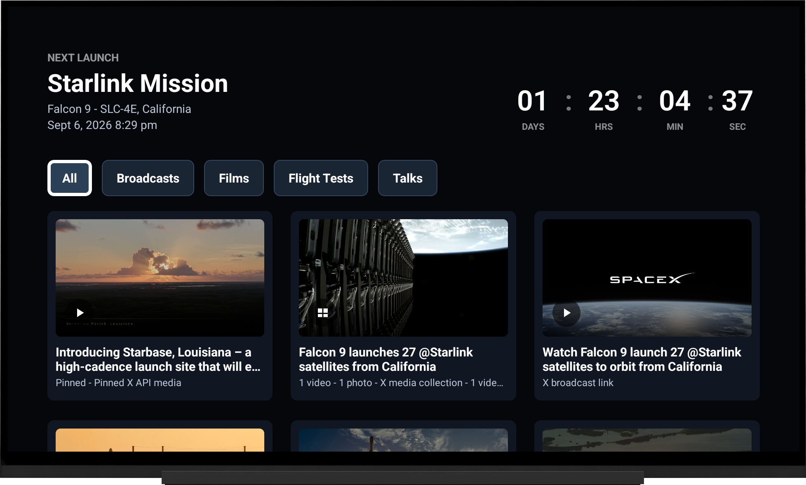
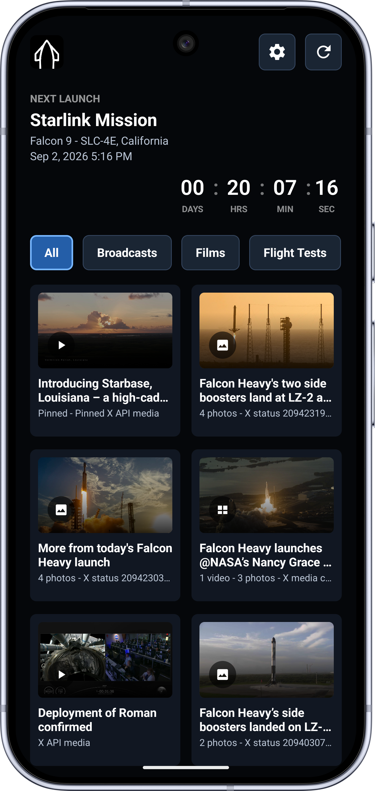
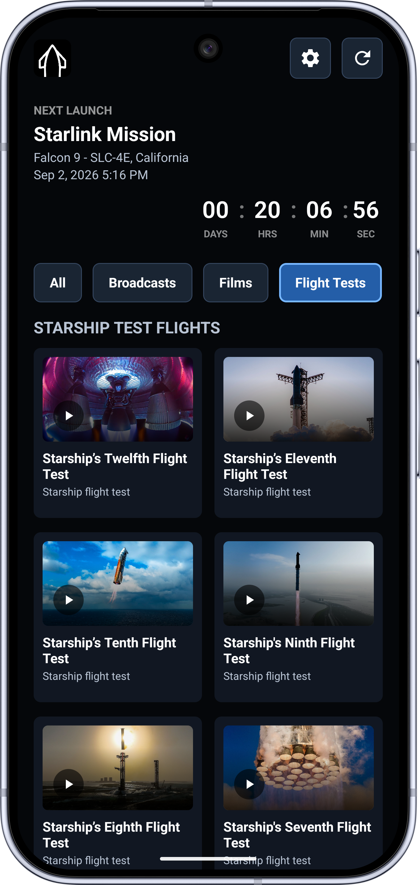
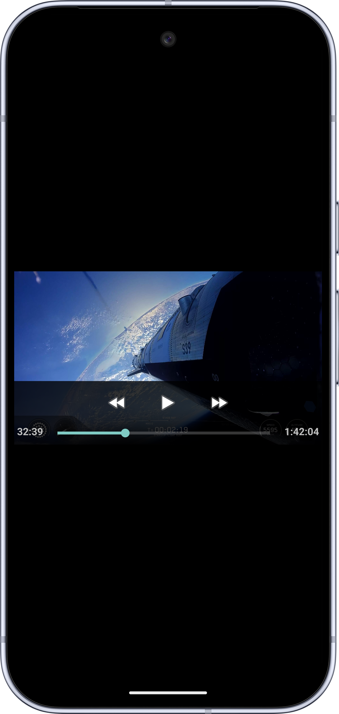

# SpaceX TV Android

Android TV port of the SwiftUI/tvOS/iOS [SpaceX TV](https://github.com/sighmon/SpaceX-TV) app.


  

The app is implemented in Kotlin with Jetpack Compose for TV dependencies and a TV-first focusable UI. It discovers SpaceX broadcasts from either the shared hosted X API cache or a user-supplied bearer token, appends Starship media from SpaceX's public CMS playlists, shows the next launch countdown, supports photo galleries and multi-media collections, and plays resolved HLS/MP4 streams.

## Apple Sync Status

Apple SpaceX TV: https://github.com/sighmon/SpaceX-TV

Feature-complete against Apple build commit:

```text
054b2ccff0f62bb59b237cdcf5ba396bcfd50463
```

Commit summary: `054b2cc Use tvOS size display when an iOS device is connected to a 4K monitor`

Android parity included through this commit:

- Shared hosted X API cache discovery, with optional personal X API Bearer Token discovery.
- SpaceX CMS Starship films, Starship talks, and Starship flight test shelves.
- Upcoming Starship flight-test holding cards when CMS launch tiles exist before a webcast exists.
- X post video, photo gallery, and mixed media collection cards.
- Pinned, live, and upcoming card state.
- Card filters for All, Broadcasts, Films, Flight Tests, and Talks.
- Load More for X API token mode only.
- Daily app cache, cache metadata display, and Delete Caches action.
- MP4/HLS playback preference for SpaceX CMS media plus fallback stream URL storage.
- iOS-style next launch countdown with ticking day/hour/minute/second units and near-launch background refresh.
- Home footer with app icon, cache metadata, `ONLY THE PARANOID SURVIVE` 10-tap logo toggle, and `T+` watch timer.
- Settings footer with app icon, `Made on Earth by humans`, `T+` watch timer, and Android version name/code.
- Player debug overlay and total viewing time tracking.
- YouTube launch links open through Android's external `ACTION_VIEW` handler.
- Installable on Android TV, Android tablets, and Android phones.

Platform differences:

- Apple-only iOS external display/AirPlay/Now Playing controls are not applicable to Android TV.
- Android playback currently uses platform `VideoView`; the Apple app uses `AVPlayerViewController`.
- Phone/tablet layouts are intended for easier testing and use the same feature set with compact spacing; the primary product target remains Android TV.

## Build

```sh
./gradlew assembleDebug
```

Use JDK 17 or newer to build. If your system Java is too old, set `org.gradle.java.home` locally in `~/.gradle/gradle.properties` or via your shell/IDE environment rather than committing a machine-specific path.

## Settings

Open Settings from the app header. By default the app uses the shared hosted X API cache. To use live X API discovery, enter an X API Bearer Token and turn on **Use your Bearer Token**. The token is stored in app `SharedPreferences`; it is not hard-coded in the project, and Android backup is disabled so it is not included in device/cloud backups.

## Output

Debug APK:

```text
app/build/outputs/apk/debug/app-debug.apk
```

## Sideload

For Android TV over ADB:

```sh
adb connect <tv-ip-address>:5555
adb install -r app/build/outputs/apk/debug/app-debug.apk
```

For a phone or tablet connected by USB:

```sh
adb devices
adb install -r app/build/outputs/apk/debug/app-debug.apk
```
